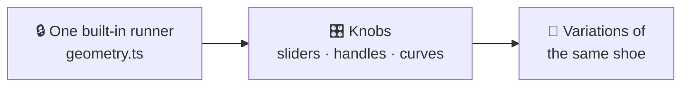
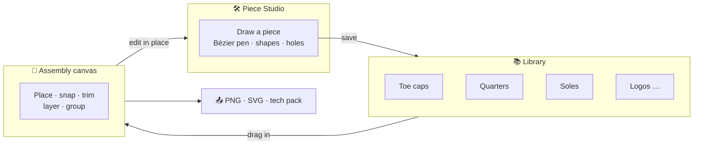
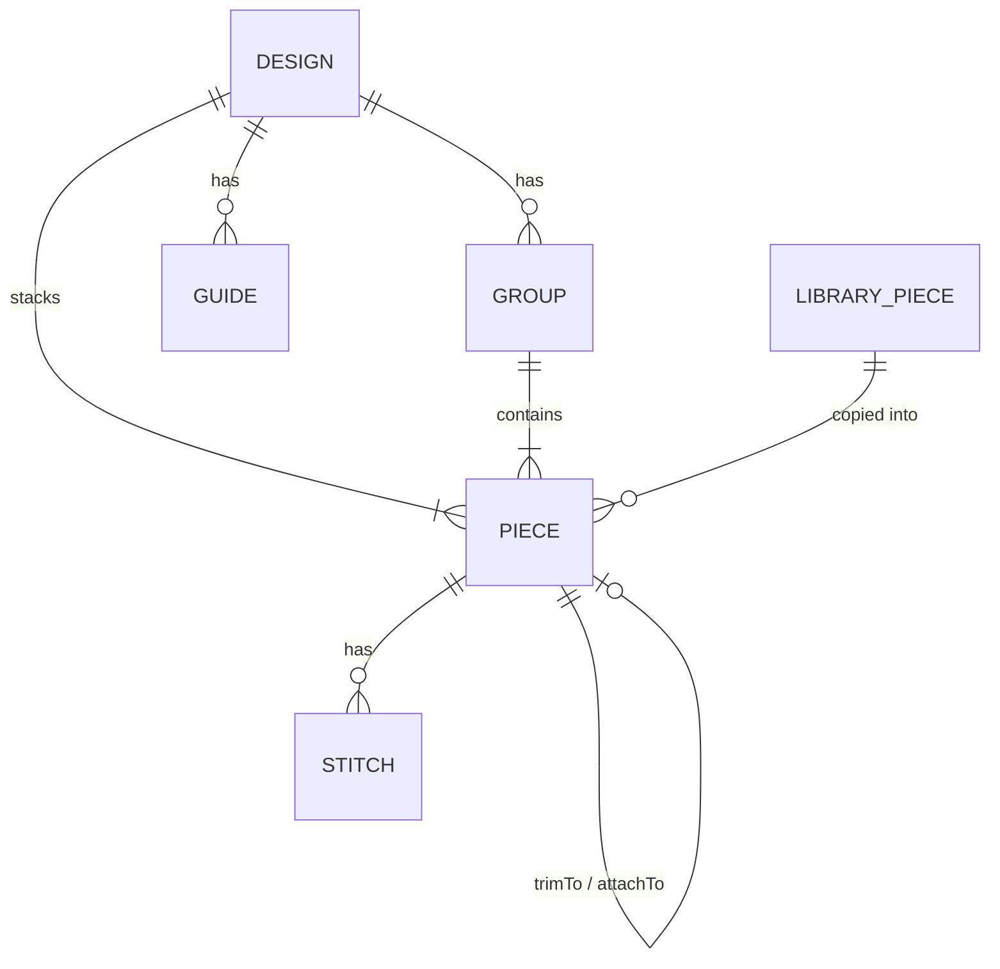
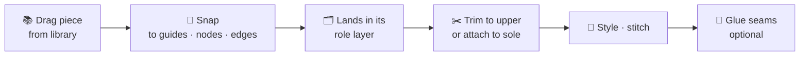
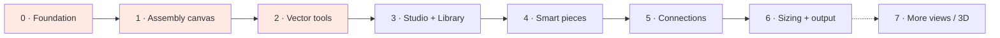

# 🧩 Plan: From a Template to a Piece-Based Sneaker Designer

> **Goal:** start from *your own* idea, design every piece separately, then bring the pieces together to form a shoe.

---

## 1. Why it still feels rigid

Today the app is **one parametric shoe with knobs**. Every feature added so far (shape handles, curves, toe styles, editable outlines) was a new knob on the same template.



| Today | Why it limits you |
|---|---|
| A single silhouette generator | Every design starts as the same runner |
| 12 fixed parts with fixed roles | You can't have two toe caps, a split vamp, or a piece the app doesn't know about |
| Built-in parts are **derived** from global shape knobs | You can't design a part on its own; changing one knob moves everything |
| Your own parts are bolted on | They're second-class: no Bézier handles, no holes, a fixed layer band |
| Fixed stacking order | A piece can't sit between, say, the collar and the eyestay |

The template approach was the right first step: it got a good-looking shoe on screen quickly. But it has hit its ceiling.

---

## 2. The new idea in one picture

> **A shoe is an ordered stack of independent pieces.** A template is just one way to *start*, not the thing you're stuck inside.



---

## 3. Four ways to start a design

```
┌──────────────────────── New design ────────────────────────┐
│                                                            │
│  ⬜ Blank canvas      🖼️ Trace a sketch                     │
│  Ground line and an   Upload a drawing, then draw pieces   │
│  optional last guide  over it                              │
│                                                            │
│  👟 From a template   📚 From my pieces                     │
│  Runner, Court, High- Build from pieces in your library    │
│  Top… converted into                                       │
│  editable pieces                                           │
└────────────────────────────────────────────────────────────┘
```

All four end up in the same place: a list of pieces you fully own. Nothing is locked to a template.

---

## 4. Core concepts

| Concept | What it is | Example |
|---|---|---|
| **Piece** | One independent shape with its own style, stitching and transform | Toe cap, quarter, midsole, "JL" logo |
| **Free piece** | A vector path you draw and edit node by node | A hand-drawn side panel |
| **Smart piece** | A piece made by a generator with settings; can be **detached** into a free piece | Sole builder, lacing system, text along a path |
| **Library piece** | A saved piece you can reuse; placing it makes a copy | "My square toe cap v2" |
| **Guide** | A helper line or shape that is never exported | Last outline, ground line, sole line, lacing line |
| **Group** | Pieces that move, scale and hide together | "Bottom unit" = midsole + outsole + pads |
| **Relationship** | How pieces connect | *Trim to* the upper, *attach to* the sole, *glued seam* |

---

## 5. Data model (v3)

```ts
interface Design {
  id: string
  name: string
  version: 3
  unit: 'mm'                 // real-world units, graded by size
  sizeEU: number
  view: 'lateral'            // medial and top views come later
  pieces: Piece[]            // array order = stacking order (bottom → top)
  groups: Group[]
  guides: Guide[]            // last outline, ground, sole line… never exported
  reference?: ReferenceImage // the sketch you trace
}

interface Piece {
  id: string
  name: string
  role: PieceRole            // 'upper' | 'panel' | 'overlay' | 'collar' | 'tongue' | 'eyestay'
                             // | 'lacing' | 'midsole' | 'outsole' | 'graphic' | 'detail'
  source:
    | { kind: 'path'; path: VectorPath }
    | { kind: 'smart'; generator: GeneratorId; params: Record<string, unknown> }
  transform: { x: number; y: number; rotate: number; scale: number; flipX: boolean }
  style: { color: string; material: MaterialId; opacity: number }
  stitches: StitchSpec[]     // offset, spacing, rows, color
  trimTo?: string            // clip to another piece (e.g. the upper base)
  attachTo?: string          // follows another piece when it moves
  hidden?: boolean
  locked?: boolean
  libraryRef?: { id: string; version: number }
}

interface VectorPath { contours: Contour[] }      // first = outline, the rest = holes
interface Contour { closed: boolean; nodes: PathNode[] }
interface PathNode {
  x: number; y: number                            // mm, in the piece's own space
  in?: Vec; out?: Vec                             // Bézier handles
  kind: 'corner' | 'smooth' | 'symmetric'
}
```



**Key change:** every piece has its **own coordinate space + transform**. That's what lets you design a piece by itself and then place, scale or flip it on any shoe.

---

## 6. Editor layout

```
┌─ 👟 Sneaker Designer ── [name] ───────────────── ↶ ↷  Export  Save ─┐
│ ┌─ Tools ─┐                                                         │
│ │ ▢ Select (V)   ◇ Nodes (A)   ✒ Pen (P)   ⬭ Shapes (S)   T Text    │
│ │ ┄ Stitch       ✂ Split       ⧉ Boolean   📏 Measure   🖼 Sketch    │
│ └─────────┘                                                         │
│ ┌ Layers / Library ┐ ┌──────── Canvas ────────┐ ┌── Inspector ─────┐│
│ │ ▸ Graphics       │ │                        │ │ Piece: Toe cap   ││
│ │ ▸ Lacing         │ │     (assembled shoe,   │ │ Style · Material ││
│ │ ▾ Upper          │ │      guides, sketch)   │ │ Stitching        ││
│ │   ☐ Toe cap  👁 🔒│ │                        │ │ Transform        ││
│ │   ☐ Vamp     👁 🔒│ │                        │ │ Trim to / Attach ││
│ │   ☐ Quarter  👁 🔒│ │                        │ │ Generator params ││
│ │ ▸ Bottom unit    │ │                        │ │ [Edit in Studio] ││
│ │ [+ Piece] [📚]   │ └────────────────────────┘ └──────────────────┘│
└──────────────────────────────────────────────────────────────────────┘
```

---

## 7. Piece Studio: design one piece at a time

Double-click a piece, or **+ New piece**, to open it on its own:

- A **mm grid** with rulers, and an optional faded **ghost of the shoe** behind it for context.
- A **Bézier pen** with real handles. Each node can be corner, smooth or symmetric.
- **Holes:** a second contour inside the piece, e.g. a window or eyelet holes.
- **Shapes:** rectangle, ellipse, polygon, star. **Booleans:** union, subtract, intersect.
- **Stitching:** single or double rows, set distance from the edge, spacing, color.
- **Mirror** tools and a symmetry axis for symmetric pieces like tongues and logos.
- **Save to library** with a category, tags and a thumbnail.
- **Import SVG** from Figma or Illustrator, so pieces can come from tools you already use.

---

## 8. Bringing pieces together



- **Role layers decide the default stacking** (you can always drag to override):

  | Bottom → top | Roles |
  |---|---|
  | 1 | Tongue, lining |
  | 2 | Upper base (quarter) |
  | 3 | Panels: vamp, toe cap, counter |
  | 4 | Overlays, collar, eyestay |
  | 5 | Lacing |
  | 6 | Bottom unit: midsole, outsole, pads |
  | 7 | Graphics: logos, text |

- **Snapping:** to the grid, to guides (ground, sole line, last outline), and to other pieces' nodes and edges.
- **Trim to:** clip any piece to any other piece, not only "the upper".
- **Attach to:** a piece follows its parent, so the pads follow the sole and the logo follows the quarter.
- **Glued seams** (later phase): link an edge of piece A to piece B, so moving a seam moves both pieces.
- **Coherence helpers:** they warn you but never block you.
  - The **last guide** shows the foot volume.
  - Warnings flag gaps between the upper and the sole.

---

## 9. Smart pieces (generators)

| Generator | Settings | Solves |
|---|---|---|
| **Sole builder** | Layers, thickness at toe and heel, toe spring, rocker, sidewall shape, tread | Any sole without drawing it by hand |
| **Lacing system** | Follows a path you draw; eyelet count, size and shape (round, oval, D-ring); lace style, bow | Big oval eyelets, curved lacing, laceless |
| **Stitch line** | Along any edge or free path; rows, spacing | Decorative and double stitching |
| **Text / logo** | Font, size, rotation, along a path | "JL" on the sole |
| **Perforations** | Hole size and spacing, fill a region | Perforated toe boxes |
| **Tread** | Pattern type and depth along the outsole | Outsole looks |
| **Template upper** | Today's parametric runner, court and high-top | A quick start; it "explodes" into free pieces |

Every smart piece has **Detach**, which converts it into free paths so you're never stuck with the generator.

---

## 10. What happens to today's code

| Today | Becomes |
|---|---|
| `viewer2d/geometry.ts` (one silhouette) | `templates/`: generators that **emit pieces** |
| `SneakerSvg.tsx` (12 hard-coded parts) | A generic `PieceRenderer` that draws any list of pieces |
| `customParts` | Plain pieces (they already have points, corners and style), so migration is easy |
| Catmull-Rom points | Bézier nodes. The current curves are already Bézier segments, so they convert exactly |
| Stitching mask, textures, shading | Reused per piece |
| Reference sketch | Reused as is |
| Undo/redo (`edit(recipe)`) | Reused as is |
| Colorways | Applied by piece **role** instead of fixed part ids |
| localStorage | IndexedDB for the library and images, which can hold much more |

Every saved v1/v2 design is **migrated** to v3 pieces and should look the same.

---

## 11. Tech decisions

| Decision | Recommendation | Why |
|---|---|---|
| Geometry engine | **paper.js** | Robust Bézier booleans, hit-testing, SVG import/export, offsets. Writing these by hand is weeks of work |
| Renderer | **Keep SVG** | Crisp, exportable, built-in hit-testing, and the current visuals carry over |
| Units | **mm** with a base size | Real measurements, size grading and tech packs later |
| Storage | **IndexedDB** (local), backend later | Libraries and sketches outgrow localStorage's ~5 MB |
| Tests | **Vitest** for path math, migration and stacking, plus visual snapshot tests | The editor gets complex; migrations must not break saved designs |

---

## 12. Roadmap



| Phase | Deliverables | Done when… | Size |
|---|---|---|---|
| **0 · Foundation** | v3 piece model, generic piece renderer, migration of v1/v2 designs, Vitest setup, paper.js in | Every saved design opens and looks the same, drawn by the new renderer | M |
| **1 · Assembly canvas** | Start screen (blank / sketch / template / library); select, move, rotate, scale, flip; layers panel with drag-reorder, groups, lock/hide; zoom/pan; snapping | You can arrange pieces into a shoe without touching a single slider | M |
| **2 · Vector tools** | Bézier pen, node editing, shapes, holes, booleans, split, SVG import | You can draw a complete shoe **from a blank canvas**, e.g. "JL Court" from scratch | L |
| **3 · Studio + Library** | Isolated piece editing, save/browse/insert library, ~40 starter pieces, piece SVG export | You design a toe cap once and reuse it in three shoes | M |
| **4 · Smart pieces** | Sole builder, lacing system, stitch tool, text/logo, perforations, tread | "JL" on the sole, oval eyelets and double stitching all work | L |
| **5 · Connections** | Trim to any piece, attach, glued seams, fit to last, gap warnings | Moving a seam moves both neighbouring pieces | M |
| **6 · Sizing + output** | Size grading, measurements, full SVG, per-piece pattern export, tech-pack PDF, materials list | You can hand a factory a size run and a spec sheet | M |
| **7 · More views / 3D** | Medial and top views, then 3D | Later | XL |

**Recommended first milestone: Phases 0–2.** That alone answers "let me start from my own idea". Phase 3 makes "design every piece separately" real.

---

## 13. Risks & how to handle them

| Risk | Mitigation |
|---|---|
| A Figma-level editor is a big build | Strict phase scope; lean on paper.js; ship each phase usable on its own |
| Slow dragging with many textured pieces | Skip SVG filters while dragging; memoize each piece; cache textures |
| Free pieces can form a "non-shoe" | Guides, snapping, template starts and gentle warnings, never hard blocks |
| Migration breaks old designs | Golden image tests that compare old and new renders for every preset |
| Storage limits | IndexedDB, compressed sketches, and library export/import as files |

---

## 14. Decisions needed before building

1. **Geometry engine:** add paper.js (recommended), or keep everything hand-written?
2. **Rebuild in place** with migration (recommended), or build a separate "Pro editor" next to the current one?
3. **Switch to mm units now** (recommended, it makes sizing easy later) or keep px for now?
4. **Scope:** start with **Phases 0–2** as the first milestone?
